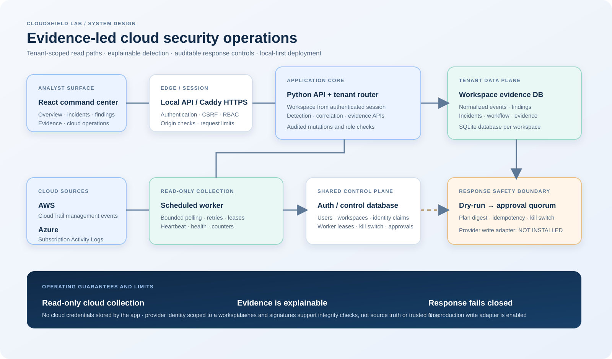
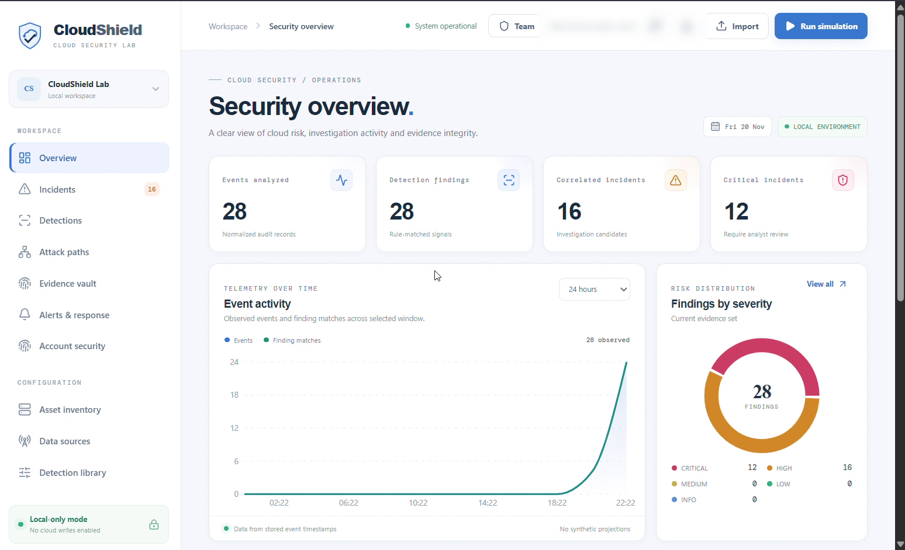
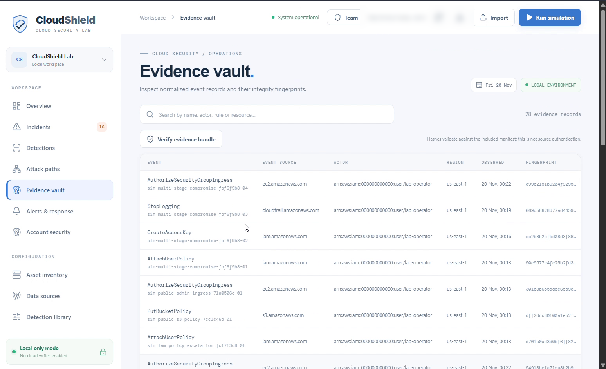
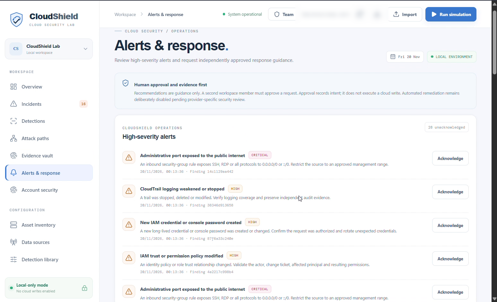

# CloudShield Lab

**An evidence-led cloud security command center for AWS and Azure.**

CloudShield is a local-first security engineering lab for collecting selected cloud audit events, explaining detections, investigating related activity and preserving verifiable evidence. It combines a responsive React console with a Python API, tenant-scoped storage and a separate read-only collection worker.

  

## Product tour

| Command center | Incident investigation | Alerting and response |
|---|---|---|
|  |  |  |

More product evidence: [guided response request](evidence/media/04-guided-response-request.png) | [tenant-scoped cloud connections](evidence/media/05-tenant-scoped-cloud-connections.png) | [sign-in screen](evidence/screenshots/sign-in-screen.png).

## What it does

- **Detect:** normalize selected AWS CloudTrail, AWS Security Hub and Azure Activity Log event shapes; evaluate explainable rules with severity and ATT&CK references.
- **Investigate:** group related findings, explore evidence-backed temporal/resource relationships, manage incident workflow and analyst notes.
- **Preserve evidence:** canonical SHA-256 fingerprints, portable incident bundles and optional detached Ed25519 signatures.
- **Operate by workspace:** isolate tenant evidence stores and scope AWS AssumeRole / Azure workload identity connections to a workspace.
- **Collect safely:** bounded scheduled read-only polling, retry limits, inventory refresh and worker health signals.
- **Control response:** action-specific dry runs, blast-radius reporting, approval quorum, idempotency and a default-on kill switch. Production cloud-write adapters are not installed; execution remains fail-closed.

## Quick start

### Local development

~~~powershell
python -m pip install -e .
python -m unittest discover -s tests -v
python -m cloudshield.api
~~~

Open http://127.0.0.1:8765. The offline workspace starts without cloud collection. Use **Run simulation** for explicitly synthetic lab events or import a supported CloudTrail / Security Hub / Azure Activity Log export.

### Local production profile (Windows)

~~~powershell
.\scripts\local-production.ps1 up --build -d
.\scripts\local-production.ps1 ps
~~~

Open https://localhost:8443. Use scripts/local-production.ps1 for the loopback-only profile; do not run the production Compose file directly on a Windows workstation.

## Security and scope

CloudShield is a security lab and portfolio project—not a certified production CSPM/SIEM, not a replacement for GuardDuty or Security Hub, and not comprehensive cloud threat detection. Provider collection is selected, bounded control-plane telemetry; it is not a streaming SIEM or authoritative full inventory. Fixture metrics are not production accuracy estimates.

Cloud credentials are not stored by the application. Cloud writes are not available because reviewed production response adapters are not installed. SQLite worker leases support a single host/shared-volume deployment, not multi-region coordination. Live provider acceptance, centralized on-call monitoring, off-host restore drills and independent penetration/tenant-isolation assessments remain release gates.

## Verification

~~~powershell
python -m compileall -q src tests
python -m unittest discover -s tests -v
python -m cloudshield.cli evaluate fixtures/detection_evaluation.json
npm ci
npm run build
npm audit --omit=dev --audit-level=low
~~~

See CI for the authoritative branch-specific workflow result. A passing automated suite does not certify external identity providers, real AWS/Azure access, cloud remediation, production detection quality or disaster recovery.

## Documentation

Start with the [documentation index](docs/INDEX.md). Key references:

- [Architecture and data flows](docs/ARCHITECTURE.md)
- [Current capabilities and boundaries](docs/CURRENT_CAPABILITIES.md)
- [Cloud operations and provider permissions](docs/CLOUD_OPERATIONS.md)
- [Deployment, backup and recovery](docs/DEPLOYMENT_OPERATIONS.md)
- [Security threat model](docs/SECURITY_THREAT_MODEL.md)
- [Detection coverage](docs/DETECTION_COVERAGE.md)
- [Detection evaluation methodology](docs/DETECTION_EVALUATION.md)
- [Evidence custody and signatures](docs/EVIDENCE_CUSTODY.md)
- [Phases 23-26 implementation and acceptance](docs/PHASES_23_26_IMPLEMENTATION_REPORT.md)
- [Phase 27 documentation and evidence record](docs/PHASE_27_DOCUMENTATION_AND_EVIDENCE.md)
- [Evidence inventory and provenance](evidence/README.md)

## License

MIT. See [LICENSE](LICENSE).
