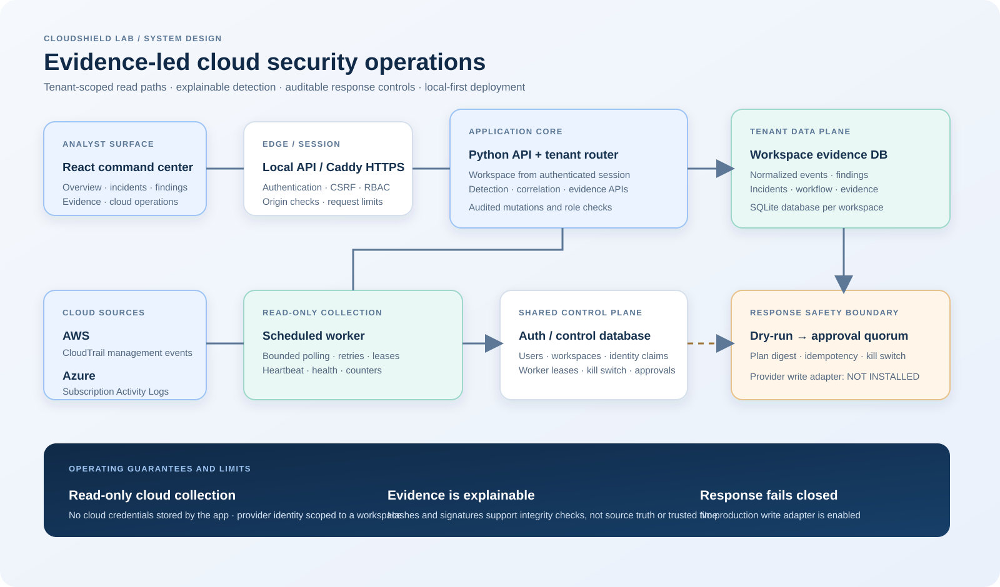

# Architecture and trust boundaries

CloudShield is a local-first application with a deliberately separated control plane, tenant evidence plane and cloud collection worker. The design prioritizes explicit scope, explainable findings and auditable state changes over broad collection or automatic remediation.

## Runtime components

| Component | Responsibility | Trust boundary |
|---|---|---|
| React command center | Analyst UI for overview, incidents, detections, evidence, data sources and response requests | Browser is untrusted; API authorization is authoritative |
| Caddy edge (production profile) | HTTPS ingress and reverse proxy to the private API | Only the edge is host-published in the production Compose profile |
| Python API | Authentication, authorization, tenant routing, ingestion, investigation and operations endpoints | Derives workspace from the authenticated server-side session |
| Detection pipeline | Normalize selected provider event shapes, evaluate deterministic rules and correlate findings | Input events and provider payloads are untrusted |
| Tenant evidence database | Persist normalized events, findings, incidents, workflow and evidence metadata | Separate SQLite database per workspace |
| Shared auth/control database | Users, workspaces, provider identity claims, worker leases, response approvals and kill-switch state | Shared control plane; access restricted to server/operator roles |
| Collector worker | Scheduled bounded read-only AWS/Azure collection and inventory refresh | Uses the configured workspace identity; no static cloud secret stored in CloudShield |
| Response-control module | Dry-run plans, impact analysis, approvals, idempotency and execution guardrails | Fails closed without an installed reviewed provider adapter |

## Data flow: cloud telemetry

~~~mermaid
flowchart LR
  A[AWS CloudTrail] --> W[Workspace collector]
  B[Azure Activity Logs] --> W
  W -->|bounded read-only requests| N[Normalize provider events]
  N --> D[Detection rules]
  D --> C[Incident correlation]
  C --> T[(Workspace evidence database)]
  T --> U[Authenticated React console]
  T --> E[Evidence export and verification]
  W <--> L[(Shared worker lease and heartbeat state)]
~~~

Collection is scheduled polling, not streaming. AWS CloudTrail management-event history and Azure subscription Activity Logs are bounded control-plane sources. Inventory refresh is intentionally partial. A connection must be configured, tested and explicitly enabled by an authorized workspace administrator. Provider identity ownership is reserved globally to prevent one provider identity from being attached to multiple workspaces.

## Tenant isolation

~~~mermaid
flowchart TB
  B[Browser request] --> S[Verified server-side session]
  S --> R[Role and workspace authorization]
  R -->|workspace A| A[(Tenant A evidence DB)]
  R -->|workspace B| C[(Tenant B evidence DB)]
  S --> G[(Shared auth/control DB)]
  G --> I[Provider identity ownership]
  G --> Q[Worker leases and response approvals]
~~~

The client does not choose an arbitrary tenant database path. The server resolves the workspace from the authenticated session and applies role checks before tenant-scoped operations. Local legacy mode is a single-user development mode and must not be exposed to an untrusted network.

## Controlled response lifecycle

~~~mermaid
sequenceDiagram
  actor Analyst
  participant API as CloudShield API
  participant Plan as Response planner
  participant DB as Shared control DB
  participant Adapter as Provider adapter boundary
  Analyst->>API: Request containment
  API->>Plan: Build action-specific dry run
  Plan-->>API: Targets, preconditions, blast radius, digest
  API->>DB: Persist request and initial independent approval
  Analyst->>API: Request execution
  API->>DB: Verify quorum, plan digest, expiry, idempotency and kill switch
  API->>Adapter: Execute only if all guards pass
  Adapter-->>API: Result and rollback metadata
  Note over API,Adapter: No production AWS/Azure write adapter is installed. Execution fails closed.
~~~

Execution is intentionally unavailable until a provider-specific adapter has been implemented, reviewed and tested in isolated cloud accounts. Keep the service-wide kill switch enabled. Do not set the execution opt-in in production. Test fakes validate orchestration logic; they do not demonstrate real cloud containment or rollback.

## Evidence model

- Imported and collected provider events are treated as untrusted input.
- Canonical SHA-256 fingerprints detect changes relative to a known digest; they do not prove origin, truth or trusted time.
- Portable evidence bundles include incident/event/finding references and integrity metadata.
- Optional Ed25519 signatures protect a bundle against undetected modification when the public key is trusted independently.
- Temporal and resource graph edges describe observed relationships or bounded hypotheses, not verified causality or a complete attack path.

## API surface

The API includes health/readiness, authenticated workspace operations, dashboard/analytics, event ingestion, simulation, incident workflow, evidence export/verification, cloud connection configuration/testing, live collection status, response planning/approval and administrator metrics. Exact provider permissions and operator procedures are documented in [Cloud operations](CLOUD_OPERATIONS.md).

## Deployment model

- Local development: loopback-bound Python API and local evidence database.
- Windows local-production profile: Caddy HTTPS on loopback ports 8088/8443; use scripts/local-production.ps1.
- Production Compose template: private application network behind Caddy HTTPS ingress, multi-user auth and externally supplied secrets.
- Worker coordination currently uses SQLite in the shared auth database. This is single-host/shared-volume coordination, not a multi-region distributed lock service. Move coordination and durable jobs to PostgreSQL or a queue before multi-host scaling.

## Explicit non-goals and release gates

CloudShield is not a certified CSPM/SIEM, a full provider inventory service, a streaming event platform, an autonomous remediation system or an HA multi-region service. Live AWS/Azure account acceptance, Firebase MFA policy enforcement, real SMTP delivery, external backup restore, centralized on-call monitoring, load/failover testing and independent security assurance require separately provisioned infrastructure and evidence.

See [current capabilities](CURRENT_CAPABILITIES.md), [security threat model](SECURITY_THREAT_MODEL.md), [cloud operations](CLOUD_OPERATIONS.md) and [Phase 23–26 acceptance report](PHASES_23_26_IMPLEMENTATION_REPORT.md).
